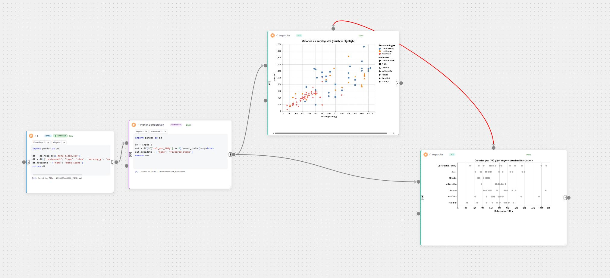

# Extra credit: Curio prototype

A Curio dataflow of our Task 1 chart (calories vs serving size, 98 menu items from 7 restaurants), with linked brushing between two views.

**Analytical question.** Which restaurants serve items that are heavy in calories for their size, and where do the large, high-calorie items sit? (Same question as Q2 in Assignment 2.)

## Dataflow (`menu_density_explorer.json`)

| Node | Type | What it does |
|---|---|---|
| Data Loading | Data Loading | Reads `menu_clean.csv` (our Assignment 2 dataset) and keeps `restaurant, type, item, serving_g, calories, cal_per_100g` |
| Python Computation | Python Computation | Keeps rows with `cal_per_100g >= 0` (all 98 items). The threshold can be raised to filter out low-density items |
| Vega-Lite (scatter) | Vega-Lite | Serving size vs calories, color = restaurant type, shape = restaurant, with an **interval brush** |
| Vega-Lite (density) | Vega-Lite | One row per restaurant, items placed by calories per 100 g; items brushed in the scatter turn orange, the rest are gray |

Edges: Data Loading → Python Computation → both Vega-Lite nodes (data), plus an **interaction edge** between the two Vega-Lite nodes (the small square handles).

## How the interaction works
**Brushing and linking.** Drag a rectangle in the scatter. Because of the interaction edge, the same items turn orange in the lower chart, so you can see where, for example, the large high-calorie items fall on the calories-per-100 g scale and which restaurants they belong to. Hovering a point shows its item name and values.

## Screenshots (`screenshots/`)
1. `curio_1_overview.png`: the dataflow after Run All, all nodes Done.

2. `curio_2_brush_link.png`: a brush over the large, high-calorie region of the scatter; those items are orange in the lower chart.
)

## Run it (Curio installed from git, as the assignment requires)
```bash
git clone https://github.com/urban-toolkit/curio.git
cd curio
conda create -n curio python=3.12
conda activate curio
pip install -r requirements.txt
conda install -c conda-forge nodejs=26
```
1. Copy `menu_clean.csv` from this folder into the **curio** folder you just cloned (Curio reads files relative to the folder it starts from).
2. From that folder run `python curio.py start`. The first start builds the frontend and takes several minutes. Then open http://localhost:8080.
3. **File > Load dataflow** and choose `menu_density_explorer.json`. If the Data Loading node asks for the file, pick `menu_clean.csv` with **Choose file**.
4. Click **Run All** and wait for every node to say Done.
5. Drag a box in the scatter and look at the lower chart.

### Alternative: Docker (also a local install from the git clone)
Described on the Curio install page; we did not use it ourselves, we ran the steps above.
```bash
git clone https://github.com/urban-toolkit/curio.git
cd curio
docker compose up
```
Then open http://localhost:8080 (the first run builds the image and takes a while). In Curio choose **File > Load dataflow** and pick `menu_density_explorer.json`. If the Data Loading node asks for data, click **Choose file** and pick `menu_clean.csv` from this folder. Then continue from step 4 above.

Built and run on Windows with Chrome, Curio 0.17.267 cloned from GitHub, Python 3.12 and Node 26 in a conda environment, served at http://localhost:8080.
