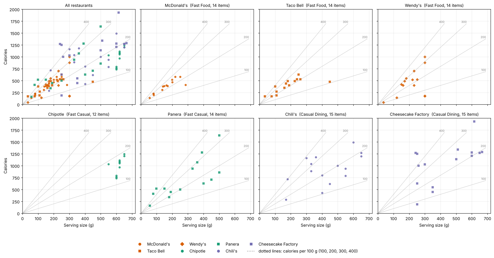
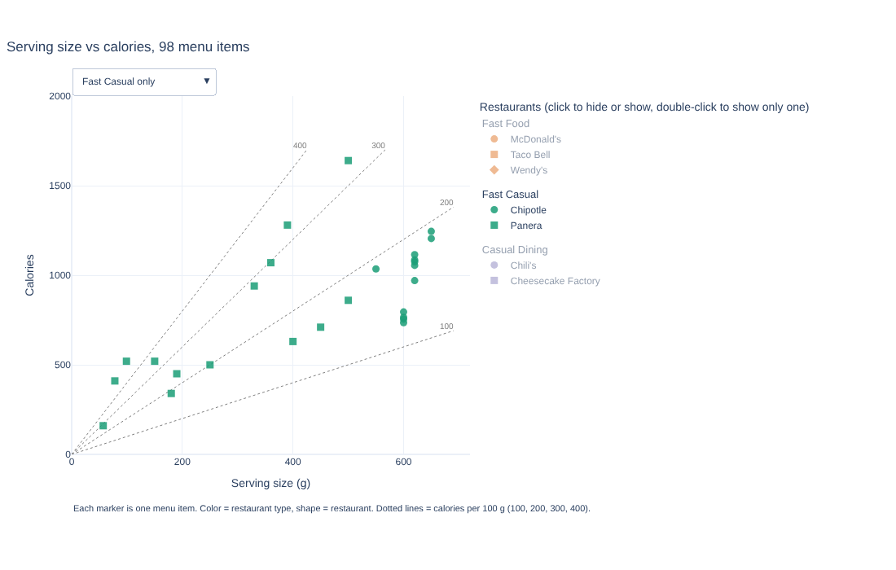
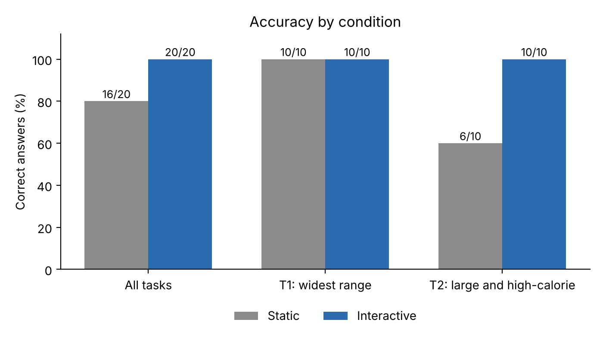
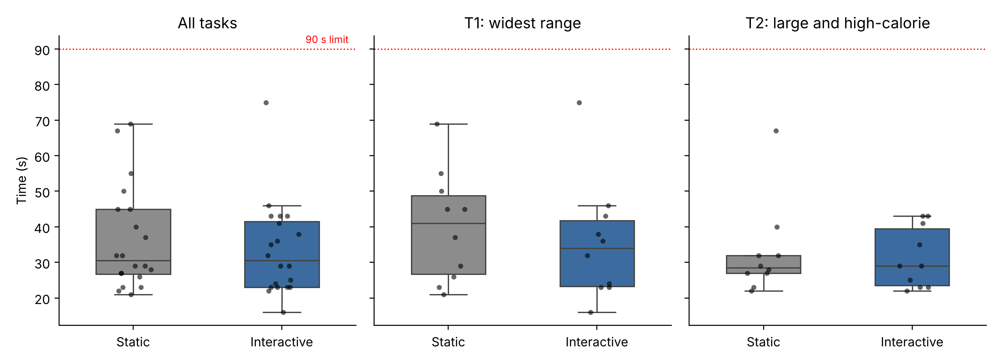
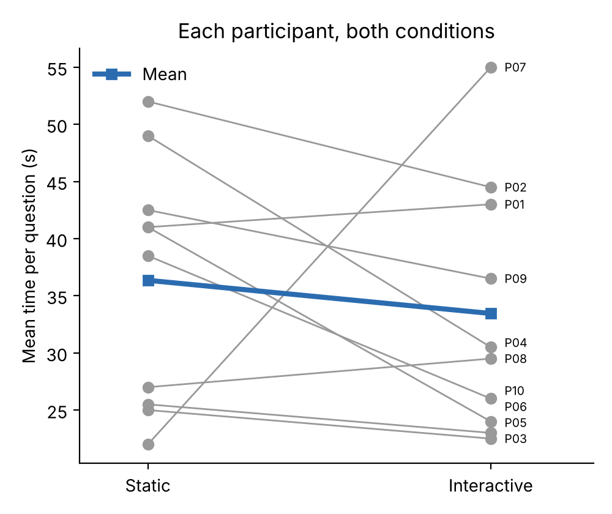

# Assignment 3: Interaction and evaluation

**Files.** [static](visualizations/static.html) and [interactive](visualizations/interactive.html) versions, [results.csv](evaluation/results.csv), [answer key](evaluation/answer_key.csv), [assignment plan](evaluation/assignment_plan.csv), [Task 1 notebook](notebooks/Assignment_3.ipynb), [Task 4 notebook](notebooks/Assignment_3_analysis.ipynb) ([HTML copy](notebooks/Assignment_3_analysis.html)), [charts](results_figures/). Run instructions: [README](README.md).

## Task 1: Implementing interaction

**Visualization.** We selected the serving size vs calories scatterplot from Assignment 2 (Direction A), with dotted lines of equal calories per 100 g. It supports our size-vs-density question (Q2) and benefits from interaction because 98 dots from 7 restaurants overlap, especially Fast Food in the lower left. Both versions use the same data (`menu_clean.csv`), encodings (position, color for restaurant type, a marker shape per restaurant), density lines and axes.

**Static version** ([`static.html`](visualizations/static.html)): small multiples, one panel with all items and one per restaurant, on identical axes.

**Interactive version** ([`interactive.html`](visualizations/interactive.html), Plotly): filtering by restaurant (legend or dropdown of subsets), zoom and pan (scroll, drag, double-click to reset) and hover for the item name.

**Why it should help, and fairness.** Filtering puts two or three restaurants in one chart, where the static version needs comparison across panels; zoom separates overlapping dots. Static may still be faster for scanning all restaurants, so we do not assume interaction wins. No task needs an item name (hover only). The interactive condition bundles filtering, zoom and pan, so differences cannot be credited to one feature (see Task 5). **Run:** open the HTML files in a browser, or rebuild with [`notebooks/Assignment_3.ipynb`](notebooks/Assignment_3.ipynb).

---

## Task 2: Evaluation design

**Question and hypotheses.** Does interaction help people compare restaurants on calories and serving size? H1: accuracy is the same or higher with the interactive version. H2: completion time is shorter with it, because filtering puts the compared restaurants in one chart. Either result, including no difference or static being better, is acceptable.

**Design.** Within-subject: each participant answers 4 questions, 2 with each version. Both tasks need only the serving-size and calorie axes (no item names, no calculation) and relate to Q2.

| Task | Question (read as written) | Variant A, answer | Variant B, answer |
|---|---|---|---|
| T1 spread across 3 restaurants | "Which of these three restaurants has the widest range of calories, from its lowest-calorie item to its highest-calorie item?" | Cheesecake Factory, McDonald's, Wendy's → **Cheesecake Factory** (range 1,740 vs 959, 440) | Panera, Chipotle, Taco Bell → **Panera** (1,480 vs 510, 460) |
| T2 counts using both axes | "Which of these two restaurants has more items that are both over 400 g and over 1,000 calories?" | Cheesecake Factory vs Panera → **Cheesecake Factory** (7 vs 1) | Chipotle vs Chili's → **Chipotle** (7 vs 3) |

*How participants answer:* T1, compare how far apart each restaurant's lowest and highest dots are; T2, count the dots right of 400 g and above 1,000 calories (a rough count is enough). Expected answers come from `menu_clean.csv` ([`answer_key.csv`](evaluation/answer_key.csv)); participants never see these numbers.

**Design decisions.** Our first task idea asked participants to judge calories per 100 g against the dotted lines. We dropped it because it needed a long explanation and many items sit close to a line, making answers ambiguous. The final questions name the restaurants but not the method, and every correct answer leads by a clear margin so variants A and B have similar difficulty.

**Counterbalancing.** Variant set X = {T1-A, T2-A}, set Y = {T1-B, T2-B}. Half the groups start with static, half with interactive, and each set is used once in each condition, so neither version always gets the same questions. Within a condition T1 comes before T2.

| Group | First condition | Static gets | Interactive gets |
|---|---|---|---|
| G1 | Static | X | Y |
| G2 | Static | Y | X |
| G3 | Interactive | X | Y |
| G4 | Interactive | Y | X |

Achieved: G1 3, G2 2, G3 3, G4 2 participants (5 started with each condition); X was on static for 6 participants and Y for 4.

**Measurements and scoring (fixed before the study).** Accuracy (1 correct, 0 incorrect) and time in seconds, by stopwatch from the end of the question being read to the participant saying "final". Time limit 90 s: no answer by then counts as timed out (accuracy 0, time 90). The first final answer counts, "don't know" scores 0, and all trials stay in the analysis. The facilitator also notes any struggles (encodings, controls, a task). Confidence and difficulty ratings were not collected.

**Procedure.** (1) Read the script and record the group. (2) Unscored practice question in each condition (Chili's or McDonald's: more items over 400 g and 1,000 calories?). (3) First condition: 2 timed questions. (4) Second condition: 2 timed questions. (5) Note any struggles. Same laptop, browser and files (`static.html`, `interactive.html`) for everyone; tasks and implementation are frozen once the main study starts.

**Script.** "You will see charts of menu items from restaurants: each dot is an item, its position shows serving size and calories, and the dotted lines show calories per 100 g. You will answer four questions, two with each version. Please answer as quickly as you can while staying correct. Say 'final' with your answer. Each question has a 90 s limit. Nothing is being tested about you, only the charts." Interactive adds: "You may use the legend, dropdown, zoom and pan." Static adds: "This version cannot be changed."

---

## Task 3: Conducting the evaluation

**Pilot.** Two people, siblings of group members (not counted), completed the protocol first. No struggles were noted, so tasks, script and files were kept as designed. Pilot data are not in `results.csv`.

**Main study.** 10 participants (P01 to P10), none in our group, each completing both conditions (4 questions, 40 rows). Same script, 90 s limit, stopwatch and laptop for all. No one timed out.

**Data** ([`evaluation/results.csv`](evaluation/results.csv), anonymous IDs, one row per participant and question):

| Column | Meaning |
|---|---|
| `participant_id` | P01 to P10 |
| `group` | 1 to 4 (counterbalancing table above) |
| `task`, `variant` | T1 or T2; A or B |
| `condition` | Static or Interactive |
| `correct` | 1 correct, 0 incorrect |
| `time_s` | seconds from question to final answer |
| `timed_out` | yes or no (90 s limit) |
| `first_condition` | condition used first (Static for groups 1 and 2, Interactive for 3 and 4) |
| `struggles` | facilitator's note for the participant, or "none noted" |

---

## Task 4: Quantitative analysis

Code: [`notebooks/Assignment_3_analysis.ipynb`](notebooks/Assignment_3_analysis.ipynb) (reads `results.csv`, writes the figures). The analysis is descriptive; with 10 participants we did not test significance.

| Condition (20 questions each) | Correct | Mean time | Median | SD | Range |
|---|---|---|---|---|---|
| Static | 16 / 20 (80%) | 36.4 s | 30.5 s | 14.5 s | 21–69 s |
| Interactive | 20 / 20 (100%) | 33.4 s | 30.5 s | 13.2 s | 16–75 s |

**Tasks.** T1 was 100% correct in both conditions (mean 35.6 s interactive vs 40.0 s static). T2 was 60% static (6/10) vs 100% interactive, with similar times (32.7 s vs 31.3 s). All four errors are one question, **T2-A in the static version** (2 of 6 correct; P03, P05, P06, P10); static T2-B and interactive T2-A were 4/4.

**Participants and order.** 7 of 10 were faster with interactive (by 2.5 to 18.5 s). P07 is the exception (22 s static vs 55 s interactive, 75 s on T1-A). The static version was slower when used first (41.1 s) than second (31.6 s); interactive took the same either way (33.6 s vs 33.3 s), so part of the static time is warm-up.

**Struggles noted.** P01 and P04 had trouble with the static axes (shared axes show numbers only on the left column and bottom row); their answers were correct but slow (69 s and 50 s). P07 struggled to figure out the interactions such as zooming (75 s, the slowest question). P02 struggled to understand T2-B (67 s). Four of the five slowest questions have a note. The four T2-A errors have no note, so these problems do not explain them; a likely contributor is that T2 needs two thresholds read across panels, which we did not test.

**Interpretation.** H1 is consistent with the data (100% vs 80%), but the whole difference comes from one question, so we cannot say interaction helps in general. H2 is only weakly supported: means differ by 3 s, medians are identical and one participant was slower, so we do not claim a time benefit.

---

## Task 5: Reflection and recommendations

**What we learned.** Interaction gave perfect accuracy and no timeouts, but not a clear speed benefit. The static small multiples were a reasonable chart (T1 100% correct). What surprised us: the identical medians, all errors falling on one static question, the static warm-up effect, and P07's slower interactive times, which came from learning the controls, not the chart. Interaction's value therefore depends on how easy its controls are to discover.

**Strengths and weaknesses.** Static shows everything at once, which suits range questions, but its axis numbers appear only on outer panels (cost to P01 and P04). Interactive avoids comparing across panels, but its controls are not obvious (P07); the legend click, dropdown and double-click reset are only explained in small text.

**Proposed changes**
1. **Axis numbers on every static panel**, with a labeled gridline at the values asked about. Addresses P01 and P04 and the two-threshold lookup in T2.
2. **A visible "how to use" line and a Reset button** in the interactive version. Addresses P07's 75 s question.
3. **Preset buttons** for common comparisons (for example by restaurant type), so users do not have to build the comparison.
4. **Log interactions** in the next study, to see which controls were used.
5. **Pilot T2 again** before reuse, since all errors fall on one variant.

**Limitations.** Only 10 participants (groups of 3, 2, 3, 2) whose background we did not record. Accuracy is near the ceiling (36 of 40 correct) and differences of a few seconds can be chance. Only two short tasks on one dataset; T2-A static is the only weak cell, and variant and condition are confounded there. X was on static for 6 participants and Y for 4. Counterbalancing spreads but does not remove learning effects. Filtering, zoom, pan and hover are bundled, and the layouts differ. Times were taken by hand, and struggles were noted per participant, not per question.
